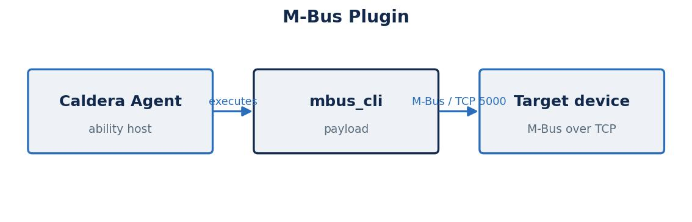

# M-Bus
M-Bus (Meter-Bus, EN 13757) protocol abilities for Caldera for OT.

v1.0.0 released 3 Nov 2026

## Overview
The M-Bus plugin provides __5__ unique abilities specific to the M-Bus protocol. This is accomplished not through exploitation, but rather by leveraging native functionality within the protocol. M-Bus (Meter-Bus) is standardized as EN 13757. This plugin uses M-Bus over TCP. Protocol documentation is available free of charge from [m-bus.com](https://m-bus.com/documentation).

The following table outlines MITRE ATT&CK for ICS coverage provided by the M-Bus plugin.

|Collection|Discovery|Inhibit-Response-Function|
|:--|:--|:--|
|Monitor Process State|Remote System Discovery|Device Restart/Shutdown|
 | |Denial of Service|

### Ability Overview Tables
The following table(s) list each plugin ability by their corresponding tactic.

#### Collection Abilities
|Name|Tactic|Technique|Technique Id|
|:--|:--|:--|:--|
|[M-Bus - Read Meter](#m-bus---read-meter)|collection|Monitor Process State|T0801|

#### Discovery Abilities
|Name|Tactic|Technique|Technique Id|
|:--|:--|:--|:--|
|[M-Bus - Ping Address](#m-bus---ping-address)|discovery|Remote System Discovery|T0846|
|[M-Bus - Scan Bus](#m-bus---scan-bus)|discovery|Remote System Discovery|T0846|

#### Inhibit-Response-Function Abilities
|Name|Tactic|Technique|Technique Id|
|:--|:--|:--|:--|
|[M-Bus - Application Reset](#m-bus---application-reset)|inhibit-response-function|Device Restart/Shutdown|T0816|
|[M-Bus - Broadcast Reset (DoS)](#m-bus---broadcast-reset-dos)|inhibit-response-function|Denial of Service|T0814|


## Architecture
This section describes the main components of the plugin and how they interface.

### Block Diagram


The M-Bus plugin exposes several new protocol specific abilities to your Caldera instance. The abilities are executed from a host running a Caldera agent via the corresponding payload. Abilities must target devices that support the M-Bus protocol to achieve described effects. By default the plugin will use __5000__ for all communication.

### Payloads
The M-Bus plugin includes 1 distinct payload(s) that implement the abilities:

- `mbus_cli`: &emsp; Generic M-Bus client; one subcommand per ability, parameterized by facts.
  - Compatible with Linux, Windows, macOS
  - Compiled with PyInstaller (Python 3.10)

### Libraries
The following libraries were used to build the M-Bus payloads:  

|Library|Version|License|
|:--|:--|:--|
|[pyMeterBus](https://pypi.org/project/pyMeterBus/)|[0.8.x](https://pypi.org/project/pyMeterBus/)|[BSD-3-Clause](https://github.com/ganehag/pyMeterBus/blob/master/LICENSE)|

## Usage
This section describes how to initially deploy and execute the abilities present within the M-Bus plugin.

### Deployment
1. Identify the target system you would like to communicate with via the M-Bus protocol.
2. Identify a viable host for the Caldera agent that will be sending M-Bus messages to the target system.
3. Deploy the Caldera agent to the viable host.
4. Run a combination of the M-Bus plugin abilities to achieve the desired effect.  

*Reference the Caldera training plugin for a step-by-step tutorial on how to deploy an agent and run abilities via an operation.*

### Abilities
#### M-Bus - Read Meter
Read an M-Bus meter's data (REQ_UD2 -> RSP_UD), disclosing its measured values
(volume, flow, temperature, ...) and their units.
  

__Usage:__  
linux: (sh)  
```
COMMAND>> ./mbus_cli #{mbus.server.ip} --port #{mbus.server.port} read #{mbus.address}

```  

__Facts:__  
- `mbus.server.ip`: Target M-Bus-over-TCP gateway IP address
- `mbus.server.port`: Target M-Bus-over-TCP port (default 5000)
- `mbus.address`: M-Bus primary address of the meter
windows: (psh)  
```
COMMAND>> .\mbus_cli.exe #{mbus.server.ip} --port #{mbus.server.port} read #{mbus.address}

```  

__Facts:__  
- `mbus.server.ip`: Target M-Bus-over-TCP gateway IP address
- `mbus.server.port`: Target M-Bus-over-TCP port (default 5000)
- `mbus.address`: M-Bus primary address of the meter
darwin: (sh)  
```
COMMAND>> ./mbus_cli_darwin #{mbus.server.ip} --port #{mbus.server.port} read #{mbus.address}

```  

__Facts:__  
- `mbus.server.ip`: Target M-Bus-over-TCP gateway IP address
- `mbus.server.port`: Target M-Bus-over-TCP port (default 5000)
- `mbus.address`: M-Bus primary address of the meter
#### M-Bus - Ping Address
Probe an M-Bus primary address with SND_NKE and check for an ACK (0xE5),
confirming a meter is present at that address.
  

__Usage:__  
linux: (sh)  
```
COMMAND>> ./mbus_cli #{mbus.server.ip} --port #{mbus.server.port} ping #{mbus.address}

```  

__Facts:__  
- `mbus.server.ip`: Target M-Bus-over-TCP gateway IP address
- `mbus.server.port`: Target M-Bus-over-TCP port (default 5000)
- `mbus.address`: M-Bus primary address of the meter
windows: (psh)  
```
COMMAND>> .\mbus_cli.exe #{mbus.server.ip} --port #{mbus.server.port} ping #{mbus.address}

```  

__Facts:__  
- `mbus.server.ip`: Target M-Bus-over-TCP gateway IP address
- `mbus.server.port`: Target M-Bus-over-TCP port (default 5000)
- `mbus.address`: M-Bus primary address of the meter
darwin: (sh)  
```
COMMAND>> ./mbus_cli_darwin #{mbus.server.ip} --port #{mbus.server.port} ping #{mbus.address}

```  

__Facts:__  
- `mbus.server.ip`: Target M-Bus-over-TCP gateway IP address
- `mbus.server.port`: Target M-Bus-over-TCP port (default 5000)
- `mbus.address`: M-Bus primary address of the meter
#### M-Bus - Scan Bus
Sweep a range of M-Bus primary addresses (SND_NKE to each), enumerating the
meters present on the bus / behind the gateway.
  

__Usage:__  
linux: (sh)  
```
COMMAND>> ./mbus_cli #{mbus.server.ip} --port #{mbus.server.port} scan --start #{mbus.scan.start} --end #{mbus.scan.end}

```  

__Facts:__  
- `mbus.server.ip`: Target M-Bus-over-TCP gateway IP address
- `mbus.server.port`: Target M-Bus-over-TCP port (default 5000)
- `mbus.scan.start`: First primary address in the scan range
- `mbus.scan.end`: Last primary address in the scan range
windows: (psh)  
```
COMMAND>> .\mbus_cli.exe #{mbus.server.ip} --port #{mbus.server.port} scan --start #{mbus.scan.start} --end #{mbus.scan.end}

```  

__Facts:__  
- `mbus.server.ip`: Target M-Bus-over-TCP gateway IP address
- `mbus.server.port`: Target M-Bus-over-TCP port (default 5000)
- `mbus.scan.start`: First primary address in the scan range
- `mbus.scan.end`: Last primary address in the scan range
darwin: (sh)  
```
COMMAND>> ./mbus_cli_darwin #{mbus.server.ip} --port #{mbus.server.port} scan --start #{mbus.scan.start} --end #{mbus.scan.end}

```  

__Facts:__  
- `mbus.server.ip`: Target M-Bus-over-TCP gateway IP address
- `mbus.server.port`: Target M-Bus-over-TCP port (default 5000)
- `mbus.scan.start`: First primary address in the scan range
- `mbus.scan.end`: Last primary address in the scan range
#### M-Bus - Application Reset
Send an M-Bus application reset (SND_UD, CI 0x50) to a meter, resetting its
application state / selection. Disrupts the meter's current operation.
  

__Usage:__  
linux: (sh)  
```
COMMAND>> ./mbus_cli #{mbus.server.ip} --port #{mbus.server.port} app-reset #{mbus.address}

```  

__Facts:__  
- `mbus.server.ip`: Target M-Bus-over-TCP gateway IP address
- `mbus.server.port`: Target M-Bus-over-TCP port (default 5000)
- `mbus.address`: M-Bus primary address of the meter
windows: (psh)  
```
COMMAND>> .\mbus_cli.exe #{mbus.server.ip} --port #{mbus.server.port} app-reset #{mbus.address}

```  

__Facts:__  
- `mbus.server.ip`: Target M-Bus-over-TCP gateway IP address
- `mbus.server.port`: Target M-Bus-over-TCP port (default 5000)
- `mbus.address`: M-Bus primary address of the meter
darwin: (sh)  
```
COMMAND>> ./mbus_cli_darwin #{mbus.server.ip} --port #{mbus.server.port} app-reset #{mbus.address}

```  

__Facts:__  
- `mbus.server.ip`: Target M-Bus-over-TCP gateway IP address
- `mbus.server.port`: Target M-Bus-over-TCP port (default 5000)
- `mbus.address`: M-Bus primary address of the meter
#### M-Bus - Broadcast Reset (DoS)
Send a broadcast SND_NKE (address 0xFF) to re-initialize every slave on the
segment at once. Directed at all meters, this is a denial-of-service primitive
against an M-Bus bus or TCP/M-Bus gateway.
  

__Usage:__  
linux: (sh)  
```
COMMAND>> ./mbus_cli #{mbus.server.ip} --port #{mbus.server.port} broadcast-reset

```  

__Facts:__  
- `mbus.server.ip`: Target M-Bus-over-TCP gateway IP address
- `mbus.server.port`: Target M-Bus-over-TCP port (default 5000)
windows: (psh)  
```
COMMAND>> .\mbus_cli.exe #{mbus.server.ip} --port #{mbus.server.port} broadcast-reset

```  

__Facts:__  
- `mbus.server.ip`: Target M-Bus-over-TCP gateway IP address
- `mbus.server.port`: Target M-Bus-over-TCP port (default 5000)
darwin: (sh)  
```
COMMAND>> ./mbus_cli_darwin #{mbus.server.ip} --port #{mbus.server.port} broadcast-reset

```  

__Facts:__  
- `mbus.server.ip`: Target M-Bus-over-TCP gateway IP address
- `mbus.server.port`: Target M-Bus-over-TCP port (default 5000)

### Source Code
The source code for the M-Bus plugin can be found inside this plugin's [src directory](/src/).

### Copyright Notice
M-Bus (Meter-Bus) is defined by the European standard EN 13757, published by the
European Committee for Standardization (CEN).

This Caldera plugin is named M-Bus in order to describe its scope and purpose. This
plugin is not produced by or affiliated with CEN. The `mbus_cli` payload decodes
responses with the open-source [pyMeterBus](https://pypi.org/project/pyMeterBus/)
library (BSD-3-Clause).
